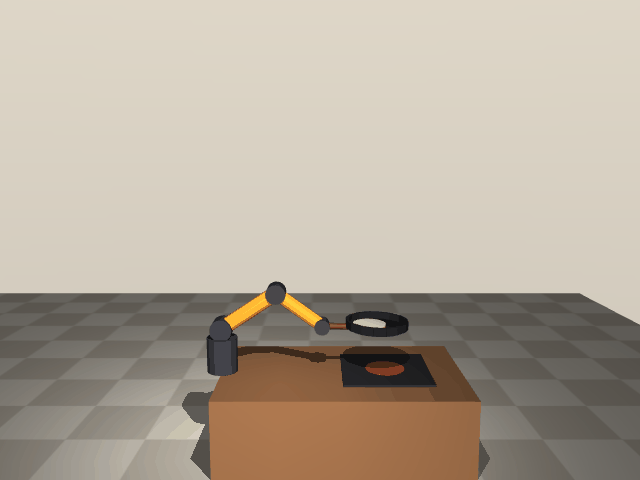

# PancakeFlip-v0

A MuJoCo + Gymnasium environment where a robot arm has to flip a pancake.

A 3-joint arm (shoulder, elbow, wrist) holds a frying pan above a stove. The
pancake starts in the pan with its **golden side down**. The agent has to toss
it so it lands back in the pan **golden side up** and stays there.

It works like the built-in MuJoCo environments (Hopper, Reacher, ...): it
subclasses `gymnasium.envs.mujoco.MujocoEnv`, registers with `gym.make`, and
passes Gymnasium's `check_env`.



## Install

```bash
pip install -r requirements.txt
```

## Quick start

```python
import gymnasium as gym
import pancake_flip  # registers the env

env = gym.make("PancakeFlip-v0", render_mode="human")
obs, info = env.reset(seed=0)
for _ in range(250):
    obs, reward, terminated, truncated, info = env.step(env.action_space.sample())
    if terminated or truncated:
        obs, info = env.reset()
```

Files:

| file | what it does |
|---|---|
| `pancake_flip/assets/pancake_flip.xml` | the MuJoCo scene (arm, pan, pancake, stove) |
| `pancake_flip/env.py` | the Gymnasium environment |
| `scripted_flip.py` | hand-tuned open-loop baseline (`--human` to watch, `--record x.gif`) |
| `train.py` | train PPO or SAC with Stable-Baselines3 |
| `record.py` | watch or record a trained model |
| `watch.py` | live viewer that follows a training run |

## The environment

**Actions** `Box(-1, 1, (3,))`: target angles for shoulder, elbow and wrist,
scaled to each joint's range. The joints are position servos, so the policy
says where to be and the servo produces the torque. Control runs at 50 Hz
(`frame_skip=10`, physics at 500 Hz).

**Observations** `Box(24,)`: arm joint angles and velocities; pancake position,
velocity and angular velocity relative to the pan; the pancake's orientation
(which way the raw side is facing, in the pan frame and in the world); pan
tilt and height; whether the pancake touches the pan; best flip progress so
far. The full table is in the `PancakeFlipEnv` docstring.

**Reward** (`reward_mode="dense"`, the default):

| term | when |
|---|---|
| airborne | `0.5 * height above pan` (capped at 0.3 m) while the pancake is in the air |
| progress | `10 * improvement in flip fraction`, only while airborne **and above the pan** |
| holding | `+1` per step while flipped and inside the pan |
| centering | small bonus for keeping the pancake near the middle of the pan |
| control | `-0.01 * ||a||²` |
| success | `+50`, episode ends |
| drop | `-10`, episode ends |

`flip fraction` goes from 0 (raw side up) to 1 (golden side up). Progress only
counts above the pan, otherwise the agent learns to fling the pancake across
the kitchen because it tumbles while falling (it tried).

`reward_mode="sparse"` keeps only the success and drop terms, for a
reward-shaping ablation.

**Success**: golden side up relative to the pan surface (normal < -0.9),
inside the pan, nearly at rest, for 10 consecutive steps (0.2 s).
**Failure**: the pancake falls more than 12 cm below the pan or onto the counter.
**Time limit**: 250 steps (5 s).

`info` contains `is_success`, `dropped`, `flipped`, `flip_frac`,
`best_flip_frac` and each reward term, so you can log them in TensorBoard.

Constructor options: `reward_mode`, `reset_noise_scale`, `pancake_mass`,
`success_bonus`, `drop_penalty`, `ctrl_cost_weight`, `settle_steps`, plus the
usual `render_mode`, `width`, `height`.

## Is it solvable?

Yes. `scripted_flip.py` is an open-loop motion (wind up, flick, hold a catch
pose) found with a cross-entropy search over 11 numbers. It doesn't look at
the pancake, so it only works when the toss happens to land:

```
scripted baseline: success 7/100, dropped 61/100
```

That is the baseline an RL agent should beat, since a closed-loop policy can
move the pan under the falling pancake.

## Training

```bash
python train.py --algo sac --steps 1000000          # recommended start
python train.py --algo ppo --steps 3000000 --n-envs 8
tensorboard --logdir runs
python record.py runs/sac_dense_s0/best_model.zip --algo sac --human
```

`EvalCallback` logs `eval/success_rate` every 25k steps and keeps the best model.

### Watching it learn

```bash
python train.py --algo sac --watch                        # live window
python train.py --algo sac --videos --show-every 100000   # mp4s in runs/<name>/videos/
```

`--watch` starts `watch.py` in a separate process. Training saves the current
policy to `runs/<name>/latest_model.zip` every 10k steps (`--save-latest-every`),
and the viewer keeps playing episodes, reloading the newest policy as it
appears, so training is never paused. You can also start or restart the viewer
yourself in another terminal at any time:

```bash
python watch.py runs/sac_dense_s0 --algo sac
```

`--videos` saves `step_00000000.mp4`, `step_00100000.mp4`, ... A sequence like
that ("flails", "holds the pan", "tosses", "flips") works well in a
presentation. TensorBoard (`tensorboard --logdir runs`) shows the reward and
success-rate curves live.

This is a hard exploration problem: the agent has to discover a violent flick
before it gets any flip reward. Expect a long phase where the agent just holds
the pan (around +5 to +10 per episode) before the first successes. A short
600k-step PPO run on a 2-core machine stayed in that phase. Budget several
million steps, ideally on a machine with more cores.

### Ways to make it learnable faster (and good experiments for the report)

- **Curriculum**: start some episodes with the pancake already in the air,
  spinning, above the pan, so the agent learns to catch before it learns to toss.
  Add this in `reset_model`.
- **Demonstrations**: pre-fill SAC's replay buffer with the scripted flips,
  or behaviour-clone the scripted policy and fine-tune with RL.
- **Residual RL**: let the policy output a correction on top of `ScriptedFlipper`.
- **Reward ablation**: dense vs. sparse, with and without the "above the pan" gate.
- **Algorithm comparison**: PPO vs. SAC vs. TD3, same seeds and step budget.
- **Robustness**: train on one `pancake_mass`, test on heavier and lighter pancakes.

## Tuning the physics

Everything physical is in the XML: link lengths and masses, servo gains (`kp`),
pan size and rim height, pancake radius, mass and friction. Joint ranges and
`ctrlrange` must match. If you change the arm, update `HOME_QPOS` in `env.py` so
the pan starts level.
